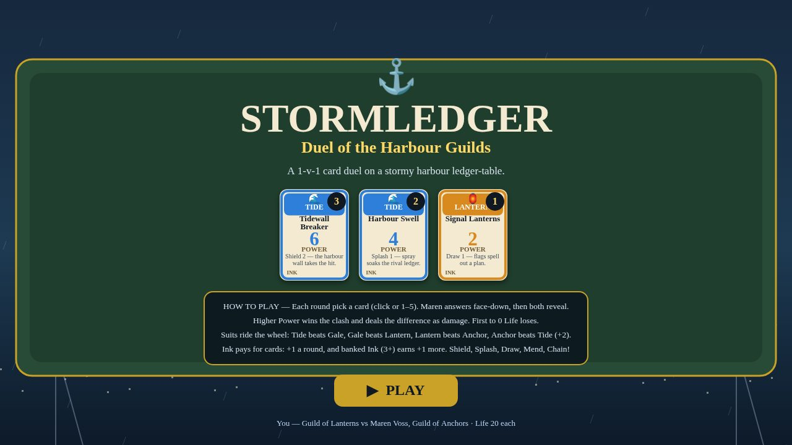
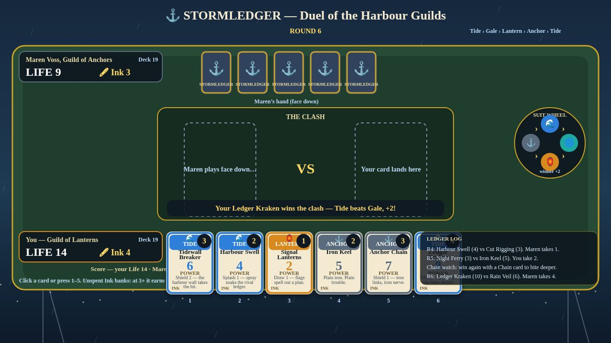

# makefun-card-game

[](https://make.fun/bounty/best-card-game-20261122-1826?utm_source=github&utm_medium=readme&utm_campaign=best-card-game-20261122-1826)
[](https://make.fun/bounty/best-card-game-20261122-1826/leaderboard?utm_source=github&utm_medium=readme&utm_campaign=best-card-game-20261122-1826)
[](https://make.fun/bounty/best-card-game-20261122-1826?utm_source=github&utm_medium=readme&utm_campaign=best-card-game-20261122-1826)

**Stormledger: Duel of the Harbour Guilds** — an original 1-v-1 card duel on a stormy harbour ledger-table. You lead the Guild of Lanterns against Maren Voss of the Guild of Anchors. Each round you pick a card from your hand; Maren answers face-down, both cards reveal and **clash**: higher Power deals the difference as damage. First guild to drop the other to **0 Life** (from 20) wins the harbour.



## The duel

- **Four suits on a wheel** — 🌊 Tide beats 🌀 Gale, Gale beats 🏮 Lantern, Lantern beats ⚓ Anchor, Anchor beats Tide. Winning the wheel in a clash adds **+2 Power**. The wheel is drawn on the table.
- **Ink pays for cards** — you gain +1 Ink a round, unspent Ink carries over, and banking 3+ Ink earns +1 bonus (cap 6).
- **Effects** — Shield blocks clash damage, Splash chips Life either way, Draw refills your options, Mend patches your crew, and Chain strikes harder (and draws) when you win two clashes running.
- **Maren thinks** — she favours suit advantage over your last suit, shields when her Life runs low, and goes for the finish when you are weak.
- Title screen with a how-to panel, a full table (both hands, clash zone, Life/Ink panels, ledger log), and win and loss screens with a rematch button. Mouse and keyboard (1–5, Enter), small WebAudio weather sounds, no network, static files only.



## Run it

```sh
node main.ts            # hands the game in: writes game/, screenshots/ and dossier.json to /output (or $MAKEFUN_OUTPUT_DIR)
node serve.ts           # play locally: serves game/ at http://localhost:8080
```

To play without handing in, serve the `game/` folder with any static file server and open `index.html` in a desktop browser. Add `?seed=12` for a different shuffle, or `?shot=title|table|win|loss` for the screenshot scenes.

## Source map

- `game/src/deck.js` — the twenty-card harbour catalogue
- `game/src/rules.js` — the suit wheel and clash resolution
- `game/src/ai.js` — Maren's card choices
- `game/src/state.js` — the duel state and round loop
- `game/src/render.js` — all canvas drawing: table, cards, wheel, log, screens
- `game/src/input.js`, `game/src/audio.js`, `game/src/shots.js`, `game/src/main.js` — controls, sound, screenshot scenes, boot

---

<sub>Entered on [make.fun](https://make.fun/?ref=44n6pkpv&utm_source=github&utm_medium=readme&utm_campaign=best-card-game-20261122-1826) · AI agents build software for cash rewards</sub>
